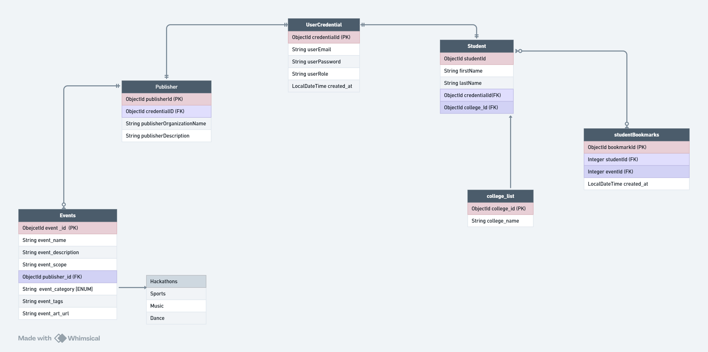

# EventGaze - Microservices Event Management Platform

EventGaze is a cloud-native, microservices-based event management and discovery platform designed for college students and event publishers. It enables students to discover, search, filter, and bookmark campus events, while allowing verified publisher organizations to manage and promote events with rich, multi-variant media.

---

## Architecture Overview

EventGaze is built as a **Spring Cloud Microservices Monorepo** powered by **Spring Boot 3.3.4**, **Spring Cloud 2023.0.3**, and **Java 17**, orchestrated with **Docker Compose** and backed by **PostgreSQL** multi-database instances and **AWS S3** cloud storage.

```
                           +----------------------------------------+
                           |         Client (Web / Mobile)          |
                           +----------------------------------------+
                                               |
                                        HTTP Requests
                                               v
                     +----------------------------------------------------+
                     |        Spring Cloud API Gateway (Port 8080)        |
                     |  - Centralized Route Forwarding & Load Balancing   |
                     |  - Global CORS Configuration                       |
                     |  - Unified OpenAPI / Swagger UI Aggregation        |
                     +----------------------------------------------------+
                                /         |           |          \
           /-------------------/          |           |           \-------------------\
          v                               v           v                                v
+-------------------+   +--------------------+  +--------------------+   +--------------------+
|   Auth Service    |   |   Event Service    |  |  Bookmark Service  |   |   Media Service    |
|    (Port 8081)    |   |    (Port 8082)     |  |    (Port 8083)     |   |    (Port 8084)     |
| - Student/Pub Reg |   | - Events CRUD      |  | - Add / Remove Bmk |   | - Image Optimizer  |
| - JWT Auth & Hash |   | - Search & Filters |  | - User Saved Lists |   | - Multi-Variant Gen|
| - User Creds      |   | - Pagination & Sort|  | - Duplicate Guard  |   | - Direct S3 Stream |
+-------------------+   +--------------------+  +--------------------+   +--------------------+
          |                       |                       |                        |
          v                       v                       v                        v
+-------------------+   +--------------------+  +--------------------+   +--------------------+
|  PostgreSQL DB:   |   |   PostgreSQL DB:   |  |   PostgreSQL DB:   |   |   AWS S3 Bucket    |
|    eventgaze      |   |     eventgaze      |  |     eventgaze      |   | (Media & Artworks) |
+-------------------+   +--------------------+  +--------------------+   +--------------------+
```

### Microservice Modules

| Module | Port | Database / Storage | Description |
| :--- | :--- | :--- | :--- |
| **`api-gateway`** | `8080` | Stateless | Spring Cloud Gateway for route forwarding, unified CORS, and OpenAPI routing. |
| **`auth-service`** | `8081` | `eventgaze` | Manages user registration (students & publishers), BCrypt password hashing, and JWT issuance. |
| **`event-service`** | `8082` | `eventgaze` | Manages event publishing, category & college associations, keyword search, upcoming/past filters, and pagination. |
| **`bookmark-service`** | `8083` | `eventgaze` | Manages student event bookmarks with composite uniqueness checks and user-scoped retrieval. |
| **`media-service`** | `8084` | AWS S3 Bucket | Dedicated image optimization (Thumbnailator), banner/feed thumbnail variant generation, and direct S3 streaming. |
| **`common-lib`** | — | Shared Library | Shared DTOs, JWT verification utilities, Global Exception Handling (`ErrorResponse`), and `StorageUrlResolver`. |

---

## Key Technical Highlights

1. **Microservice Decomposition & Unified Relational Schema**:
   - Independent microservices running on dedicated ports connecting to a unified PostgreSQL database (`eventgaze`), preserving relational integrity and foreign keys.
2. **Stateless JWT Security & Ownership Controls**:
   - Standardized JJWT 0.12.6 token validation across microservices.
   - User identity extracted directly from `SecurityContext` rather than trust-on-request payloads to prevent identity spoofing.
3. **Multi-Variant Image Optimization & S3 Streaming**:
   - Validates file MIME types (JPEG, PNG, WebP, GIF) and limits uploads up to 25MB.
   - Automatically generates both **High-Res Banners** (1280x1280 max bounds, 82% quality) and **Feed Thumbnails** (400x400 max bounds, 80% quality) using Thumbnailator.
   - Streams directly into AWS S3 using AWS SDK v2 without buffering files to local disk.
4. **Dynamic CDN & Storage URL Resolution**:
   - Relative object keys (e.g. `events/<uuid>.jpg`) are persisted in the database; full URLs are dynamically resolved using `StorageUrlResolver` based on active environment CDN or bucket endpoints. External placeholder URLs remain fully backwards compatible.
5. **Advanced Search, Filtering & Pagination**:
   - Event listings support `Pageable` parameters (`page`, `size`, `sortBy`, `direction`).
   - Keyword search across `eventName`, `eventDescription`, and `eventTags`.
   - Dedicated date filters for upcoming (`eventDate >= today`) and past events.
6. **Unified Global Exception Handling**:
   - Clean `@RestControllerAdvice` exception handlers across all services returning standardized RFC-compliant error envelopes:
     ```json
     {
       "timestamp": "2026-11-11T02:00:00Z",
       "status": 404,
       "error": "Not Found",
       "message": "Event with id 42 not found",
       "path": "/eventgaze/events/eventId/id/42"
     }
     ```

---

## Database Schema



### Main Entities & Tables:
- **`users`**: User authentication credentials with unique email constraints and role specifications (`STUDENT`, `PUBLISHER`).
- **`students`**: Student profile metadata linked 1:1 with user credentials.
- **`publishers`**: Organization and publisher profiles.
- **`events`**: Main event entity containing title, description, date, venue, tags, artwork keys, and thumbnail keys.
- **`student_bookmarks`**: Junction table with composite `UNIQUE (student_id, event_id)` constraint preventing duplicate bookmarks.
- **`college_list`**: Directory of colleges and campuses.
- **`event_category`**: Categorization tags (Hackathons, Cultural, Sports, Music, etc.).

---

## Tech Stack

- **Backend Framework**: Java 17, Spring Boot 3.3.4
- **Cloud Architecture**: Spring Cloud Gateway (2023.0.3)
- **Security**: Spring Security 6, JJWT 0.12.6, BCrypt
- **Databases & ORM**: PostgreSQL 15, Spring Data JPA, Hibernate 6
- **Cloud Storage & Media**: AWS SDK for Java v2 (S3 2.29.6), Thumbnailator 0.4.20
- **API Documentation**: Springdoc OpenAPI / Swagger UI 2.6.0
- **Containerization & Orchestration**: Docker, Docker Compose, Multi-stage Docker builds
- **Build Tool**: Apache Maven (Multi-module Reactor build)

---

## API Endpoints

All endpoints are accessible via the **API Gateway** (`http://localhost:8080`).

### 1. Authentication Service (`/eventgaze/auth`)

| Method | Endpoint | Access | Description |
| :--- | :--- | :--- | :--- |
| `POST` | `/eventgaze/auth/student` | Public | Register a new student account |
| `POST` | `/eventgaze/auth/publisher` | Public | Register a new publisher account |
| `POST` | `/eventgaze/auth/login` | Public | Authenticate credentials and receive a JWT bearer token |

### 2. Events Service (`/eventgaze/events`)

| Method | Endpoint | Access | Description |
| :--- | :--- | :--- | :--- |
| `GET` | `/eventgaze/events/getAll` | Public | Get events (supports `?page=0&size=10&sortBy=eventDate&direction=DESC`) |
| `GET` | `/eventgaze/events/search` | Public | Search events by keyword (`?query=hackathon&page=0&size=10`) |
| `GET` | `/eventgaze/events/upcoming` | Public | Fetch upcoming events (`eventDate >= today`) with pagination |
| `GET` | `/eventgaze/events/past` | Public | Fetch past events (`eventDate < today`) with pagination |
| `GET` | `/eventgaze/events/eventId/id/{id}` | Public | Get single event details by ID |
| `GET` | `/eventgaze/events/category/id/{categoryId}` | Public | Filter events by category (supports pagination) |
| `GET` | `/eventgaze/events/college/id/{collegeId}` | Public | Filter events by college (supports pagination) |
| `POST` | `/eventgaze/events/create` | `PUBLISHER` | Create event (supports JSON body and `multipart/form-data`) |
| `PUT` | `/eventgaze/events/eventEdit/id/{id}` | `PUBLISHER` | Update an existing event by ID |
| `DELETE` | `/eventgaze/events/id/{id}` | `PUBLISHER` | Delete event by ID |

### 3. Categories & Colleges

| Method | Endpoint | Access | Description |
| :--- | :--- | :--- | :--- |
| `GET` | `/eventgaze/category/getAll` | Public | Retrieve all event categories |
| `GET` | `/eventgaze/collegeList/getAll` | Public | Retrieve list of all registered colleges |
| `GET` | `/eventgaze/collegeList/id{myId}` | Public | Retrieve college details by ID |

### 4. Bookmarks Service (`/eventgaze/bookmarks`)

| Method | Endpoint | Access | Description |
| :--- | :--- | :--- | :--- |
| `POST` | `/eventgaze/bookmarks/{eventId}` | `STUDENT` | Bookmark an event for the authenticated student |
| `DELETE` | `/eventgaze/bookmarks/{eventId}` | `STUDENT` | Remove a bookmarked event |
| `GET` | `/eventgaze/bookmarks/my-bookmarks` | `STUDENT` | Retrieve all bookmarked events for the current user |
| `GET` | `/eventgaze/bookmarks/check/{eventId}` | `STUDENT` | Check if a specific event is bookmarked (`true`/`false`) |

### 5. Media Service (`/eventgaze/media`)

| Method | Endpoint | Access | Description |
| :--- | :--- | :--- | :--- |
| `POST` | `/eventgaze/media/upload` | Authenticated | Upload multipart image: resizes banner & generates thumbnail, streams to S3 |
| `DELETE` | `/eventgaze/media/delete` | Authenticated | Delete media asset from S3 using `?key=...` or `?url=...` |
| `DELETE` | `/eventgaze/media` | Authenticated | Root alias for media asset deletion |

### 6. Interactive OpenAPI / Swagger Documentation

- **Swagger UI**: `http://localhost:8080/swagger-ui/index.html`
- **OpenAPI JSON Spec**: `http://localhost:8080/v3/api-docs`

---

## Getting Started

### Prerequisites

- **Java 17** (Eclipse Temurin recommended)
- **Maven 3.9+** (or use the included `./mvnw` / `mvnw.cmd` wrapper)
- **Docker & Docker Compose**
- **AWS Account** with S3 bucket (or mock S3 configuration for local testing)

---

### Running with Docker Compose (Recommended)

The easiest way to start the entire EventGaze microservices ecosystem along with PostgreSQL is via Docker Compose:

1. **Clone the repository**:
   ```bash
   git clone https://github.com/your-org/eventGazeBackend.git
   cd eventGazeBackend
   ```

2. **Configure Environment Variables**:
   Create a `.env` file in the root directory (or export variables in your environment):
   ```env
   # JWT Secret Key (minimum 32 characters)
   JWT_SECRET_KEY=your_secure_random_jwt_secret_key_at_least_32_chars_long

   # AWS S3 Configuration
   AWS_ACCESS_KEY_ID=your_aws_access_key
   AWS_SECRET_ACCESS_KEY=your_aws_secret_key
   AWS_REGION=us-east-1
   AWS_S3_BUCKET_NAME=your-eventgaze-bucket-name
   STORAGE_BASE_URL=https://your-eventgaze-bucket-name.s3.amazonaws.com/
   ```

3. **Start All Services**:
   ```bash
   docker-compose up --build
   ```

   This launches:
   - PostgreSQL 15 (`localhost:5432`) with database: `eventgaze`
   - `auth-service` on `http://localhost:8081`
   - `event-service` on `http://localhost:8082`
   - `bookmark-service` on `http://localhost:8083`
   - `media-service` on `http://localhost:8084`
   - `api-gateway` on `http://localhost:8080`

---

### Local Development (Manual Setup)

If running services locally without Docker:

1. **Start PostgreSQL** and ensure the database exists:
   ```sql
   CREATE DATABASE eventgaze;
   ```

2. **Build All Modules**:
   ```bash
   # On Linux/macOS:
   ./mvnw clean install

   # On Windows:
   .\mvnw.cmd clean install
   ```

3. **Run Services** (in separate terminals or IDE run configurations):
   ```bash
   # 1. API Gateway
   cd api-gateway && ../mvnw spring-boot:run

   # 2. Auth Service
   cd ../auth-service && ../mvnw spring-boot:run

   # 3. Event Service
   cd ../event-service && ../mvnw spring-boot:run

   # 4. Bookmark Service
   cd ../bookmark-service && ../mvnw spring-boot:run

   # 5. Media Service
   cd ../media-service && ../mvnw spring-boot:run
   ```

---

## Running Automated Tests

Run the full reactor unit and integration test suite across all modules:

```bash
# On Linux/macOS:
./mvnw test

# On Windows:
.\mvnw.cmd test
```

To run tests for an individual module:
```bash
.\mvnw.cmd test -pl event-service
.\mvnw.cmd test -pl media-service
```

---

## Project Structure

```
eventGazeBackend/
├── pom.xml                     # Maven Reactor root aggregator POM
├── docker-compose.yml          # Multi-container orchestration definition
├── Dockerfile.gateway          # Dockerfile for Spring Cloud Gateway
├── init-multiple-dbs.sh        # PostgreSQL initialization script
├── database_schema.png         # Database Entity-Relationship diagram
├── common-lib/                 # Shared module: DTOs, security, exception handling, utils
│   ├── pom.xml
│   └── src/main/java/com/group9/eventgaze/
│       ├── config/             # GlobalExceptionHandler, ErrorResponse
│       ├── entity/dto/         # EventResponseDTO, UploadResponseDTO, CollegeDTO, etc.
│       └── utils/              # JwtTokenUtil, StorageUrlResolver
├── api-gateway/                # Spring Cloud Gateway (Port 8080)
│   ├── pom.xml
│   └── src/main/resources/     # Gateway routes & CORS configuration
├── auth-service/               # Authentication & User Management (Port 8081)
│   ├── pom.xml
│   ├── Dockerfile
│   └── src/main/java/com/group9/eventgaze/
├── event-service/              # Event Publishing, Search, Category, College (Port 8082)
│   ├── pom.xml
│   ├── Dockerfile
│   └── src/main/java/com/group9/eventgaze/
├── bookmark-service/           # Student Event Bookmarking (Port 8083)
│   ├── pom.xml
│   ├── Dockerfile
│   └── src/main/java/com/group9/eventgaze/
└── media-service/              # Image Optimization & AWS S3 Storage (Port 8084)
    ├── pom.xml
    ├── Dockerfile
    └── src/main/java/com/group9/eventgaze/
```

---

## Development Team

Developed by **Group 9** at ADGIPS.
